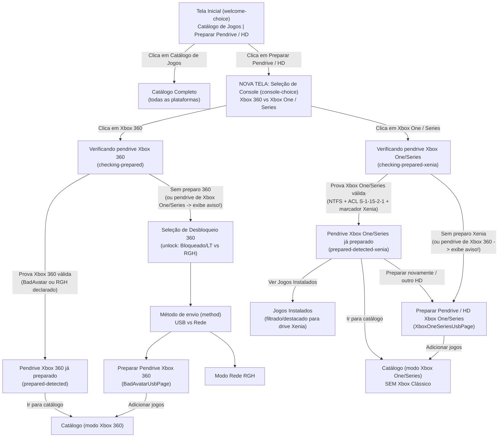

# Spec e Planejamento: Preparação de Pendrive / HD para Xbox One e Xbox Series X|S (Modo Desenvolvedor / Xenia)

- **Estado:** implementado e validado em testes automatizados e build (2026-11-25 — `498/498` testes em `npm run test:safety` + `npm run renderer:build` verde). Pendente apenas rodada de validação física em pendrive/HD real + Xbox One / Series em Modo Desenvolvedor com Xenia.
- **Objetivo:** permitir que um usuário **extremamente leigo** prepare um pendrive ou HD externo para rodar jogos de Xbox 360 no **Xbox One ou Xbox Series X|S** (com Modo Desenvolvedor e **Xenia Canary UWP**), eliminando completamente o uso externo do `XboxMediaUSB` e a configuração manual de permissões NTFS no Windows — principais fontes atuais de chamados de suporte e pedidos de reembolso.
- **Escopo desta fase:** aplicativo Desktop Windows (`src/electron-app/`) e integrações mínimas necessárias no backend Go (`src/server/`). Android mobile fica fora desta fase.

---

## 1. Visão Geral e Contexto do Problema

Hoje, o **Xbox 360 Companion** resolve de ponta a ponta a jornada do usuário de **Xbox 360** (Travado/LT via BadAvatar e RGH via Aurora/launch.ini): formata o USB em FAT32/MBR válido, grava o sistema, detecta se já está preparado e baixa jogos direto para o pendrive/HD.

Para clientes com **Xbox One ou Xbox Series X|S** em Modo Desenvolvedor (rodando Xenia), o fluxo atual exige ferramentas externas (`XboxMediaUSB`) ou ajustes manuais nas propriedades de segurança do Windows. Na prática de suporte, isso gera falhas recorrentes e reembolsos por seis causas bem conhecidas:

1. **Idioma do Windows quebrando scripts de permissão:** ferramentas ou tutoriais que usam o nome literal `"ALL APPLICATION PACKAGES"` ou `"Everyone"` falham em Windows em português (`"TODOS OS PACOTES DE APLICATIVOS"` / `"Todos"`).
2. **Herança NTFS bloqueada ou proprietário (Owner) estrangeiro:** quando o disco já tinha arquivos ou foi usado em outro PC, `icacls` falha silenciosamente em subpastas, deixando o Xenia sem acesso de leitura/escrita (*Access Denied* ou pastas vazias no console).
3. **Erros cosméticos ou reais no `System Volume Information`:** `icacls X:\ /T` tenta entrar na pasta protegida do Windows e aborta/assusta o usuário leigo com "Acesso negado".
4. **Layout de partição incompatível:** discos em FAT32/exFAT, superfloppy (sem tabela de partição), múltiplas partições ocultas (EFI/Recovery), ou HDs que o usuário formatou sem querer no Xbox como *"Jogos e Aplicativos"* (XboxFS proprietário — o disco **some do Explorador de Arquivos** sem letra no Windows).
5. **Falta de elevação UAC amigável e bloqueios do Windows:** janelas abertas do Explorer travam a formatação (`GetLastError=32`); usuários leigos não sabem o que é "Executar como Administrador".
6. **Confusão entre consoles:** usuários plugam um pendrive preparado para Xbox 360 (FAT32) no Xbox One/Series (ou um HD NTFS do Xenia no Xbox 360), ou baixam jogos do **Xbox Clássico** (que não rodam no Xenia), achando que o aplicativo falhou.

Este plano traz todo o processo para dentro do aplicativo com **UX passo a passo para usuários leigos**, **isolamento rigoroso entre Xbox 360 e Xbox One/Series**, **formatação + aplicação de ACLs via SIDs universais** e **verificação real pós-preparo** antes de exibir "Pronto!".

---

## 2. Jornada do Usuário e Fluxo de Telas (UX para Usuários Extremamente Leigos)

### 2.1 Fluxo Completo (Máquina de Estados)



### 2.2 Nova Tela: Seleção de Console (`console-choice`)

Entra **imediatamente** ao clicar em **"Preparar Pendrive / HD"** na `welcome-choice`, **antes** da verificação de pendrive preparado e **antes** da tela de desbloqueio do Xbox 360.

- **Cabeçalho:**
  - Botão **← Voltar** (retorna para `welcome-choice`).
  - Título: **"Qual é o seu videogame Xbox?"**
  - Subtítulo: *"Escolha abaixo o modelo do seu console. Cada videogame usa um formato diferente de pendrive/HD — clique na foto do seu Xbox para seguir o passo a passo certo."*
- **Dois cartões grandes lado a lado (`grid-cols-1 md:grid-cols-2`), com foto/ilustração de destaque no topo de cada cartão:**
  1. **Cartão 1 — Xbox 360** (acento visual verde clássico `#22c55e`):
     - **Imagem ilustrativa:** foto/ilustração clara dos modelos de Xbox 360 (Fat / Slim / Super Slim) empacotada localmente no app (`renderer/assets/consoles/xbox-360.webp` ou `.png`).
     - **Badge:** `Xbox 360 · FAT32 · Aurora / BadAvatar`
     - **Título:** **"Tenho um Xbox 360"**
     - **Explicação direta para leigo:** *"Se o seu videogame é um **Xbox 360** (Travado, LT ou RGH) — **clique aqui**. Vamos preparar o pendrive no formato do Xbox 360 (FAT32) com a Aurora/BadAvatar."*
     - **Rodapé clicável (CTA):** `Preparar para Xbox 360 →`
  2. **Cartão 2 — Xbox One ou Xbox Series X|S** (acento visual azul/ciano `#0ea5e9` ou esmeralda-escuro diferenciado, para **nunca parecer visualmente a mesma tela do Xbox 360**):
     - **Imagem ilustrativa:** foto/ilustração clara dos modelos de Xbox One (Fat/S/X) e Xbox Series S / Series X empacotada localmente no app (`renderer/assets/consoles/xbox-one-series.webp` ou `.png`).
     - **Badge:** `Xbox One / Series · Modo Desenvolvedor (Xenia)`
     - **Título:** **"Tenho um Xbox One ou Xbox Series X|S"**
     - **Explicação direta para leigo:** *"Se o seu videogame é um **Xbox One** ou **Xbox Series S / X** (já com o **Modo Desenvolvedor** e **Xenia**) — **clique aqui**. Vamos formatar e dar todas as permissões do HD automaticamente para só plugar e jogar no Xenia."*
     - **Rodapé clicável (CTA):** `Preparar para Xbox One / Series →`
- **Bloco de ajuda rápido ("Na dúvida de qual é o seu?"):**
  - *"• Se o seu videogame é o **Xbox 360** mais antigo (usa Aurora ou desbloqueio BadAvatar/RGH), clique na opção da **esquerda**."*
  - *"• Se o seu videogame é **Xbox One, Xbox One S/X, Xbox Series S ou Xbox Series X** e você usa o **Modo Desenvolvedor com Xenia**, clique na opção da **direita**."*
- **Ajuste sutil na `welcome-choice` (tela anterior):**
  - Atualizar o subtítulo geral e o card **"Preparar Pendrive / HD"** para deixar claro que agora prepara tanto **Xbox 360** quanto **Xbox One / Series (Modo Desenvolvedor / Xenia)**, sem aumentar o volume de texto.

### 2.3 Tela de Pendrive Já Preparado — Xbox One / Series (`prepared-detected-xenia`)

Estrutura espelhada da tela `prepared-detected` do Xbox 360 (familiar e simples), porém **visual e textualmente inequívoca** de que se trata do **Xbox One / Series (Xenia)**:

- **Selo de topo bem visível:** `XBOX ONE / SERIES · XENIA (NTFS)` (cor distinta do verde BadAvatar, ex.: azul/ciano ou índigo/esmeralda com ícone diferenciado).
- **Título:** `"Pendrive/HD preparado para Xbox One / Series encontrado!"`
- **Resumo claro:**
  - Com jogos detectados no drive Xenia: *"Encontramos o seu pendrive/HD **X:** preparado em NTFS com as permissões do Modo Desenvolvedor e **N jogo(s)** pronto(s) para o Xenia. Você pode ver os jogos já gravados ou ir direto ao catálogo para adicionar mais jogos."*
  - Sem jogos ainda: *"Encontramos o seu pendrive/HD **X:** preparado em NTFS com as permissões do Modo Desenvolvedor prontas para o Xenia. Agora você já pode ir direto ao catálogo para adicionar jogos."*
- **Botões (mesma hierarquia do Xbox 360):**
  1. **Ver Jogos Instalados (N)** (primário) → abre `UsbGamesPage` pré-selecionada no drive Xbox One/Series.
  2. **Ir para o catálogo de jogos (Xbox One / Series)** → abre `BrowsePage` no contexto `xbox-one-series` (sem Xbox Clássico).
  3. **Preparar novamente / Preparar outro pendrive ou HD** → abre `XboxOneSeriesUsbPage` (onde pode formatar do zero ou só reaplicar permissões).
  4. **← Escolher outro console** → volta para `console-choice`.

### 2.4 Tela de Preparação — Xbox One / Series (`XboxOneSeriesUsbPage.tsx`)

Espelha a simplicidade de `BadAvatarUsbPage.tsx`, adaptada 100% para o fluxo **Xbox One / Series (Xenia)**:

1. **Cabeçalho inconfundível:** badge `Xbox One / Series · Modo Desenvolvedor (Xenia)` + título **"Prepare seu pendrive ou HD para o Xbox One / Series"** + subtítulo *"Conecte seu pendrive ou HD externo. Vamos formatar em NTFS e aplicar todas as permissões que o Xenia precisa — sem precisar do XboxMediaUSB."*
2. **Seletor de dispositivo USB** (com botão **Atualizar**):
   - Lista todos os dispositivos USB externos seguros (pendrives e HDs/SSDs externos), **incluindo detecção especial de discos USB sem letra / RAW / formatados pelo Xbox para "Jogos e Apps"** (ver seção 4.5).
   - Exibe: nome amigável, letra (ou "Sem letra / Formato Xbox"), sistema de arquivos atual (`NTFS`, `FAT32`, `exFAT`, `RAW`), capacidade total, espaço livre e status de segurança.
   - **Badges de estado do dispositivo selecionado (específicos do fluxo Xbox One/Series):**
     - `preparado-xenia` (verde): *"Este dispositivo já está pronto para o Xbox One / Series (NTFS + permissões conferidas)."*
     - `preparado-outro-console` (âmbar forte): **"Este pendrive está preparado para o Xbox 360, e não para o Xbox One / Series!"** + explicação clara: *"Ele está em formato FAT32 para Xbox 360 (BadAvatar/Aurora). Se quiser usá-lo no Xbox One / Series (Xenia), deixe marcado 'Formatar e preparar do zero' abaixo (isso apagará os arquivos do Xbox 360) ou conecte outro pendrive/HD."*
     - `ntfs-sem-permissoes` (âmbar): *"Este dispositivo está em NTFS, mas faltam as permissões do Modo Desenvolvedor (ou a pasta do Xenia). Você pode corrigir as permissões sem apagar seus jogos, ou formatar do zero."*
     - `xbox-retail-unassigned` (âmbar/azul): *"Este HD está no formato de jogos originais do Xbox (ou sem letra no Windows). Marque 'Formatar e preparar do zero' para prepará-lo para o Xenia (os jogos originais dele serão apagados)."*
     - `sem-preparo` (neutro): sem badge extra; checkbox **"Formatar e preparar do zero (NTFS)"** vem **marcado e obrigatório** se o volume não for NTFS válido ou tiver layout inválido (FAT32, exFAT, RAW, múltiplas partições, superfloppy).
3. **Cards de ação (2 colunas, simples e objetivos):**
   - **Card 1 — O que será configurado automaticamente:**
     - `Formato NTFS + Permissões Xbox Dev Mode + Pastas Xenia`
     - *"Substitui o XboxMediaUSB: configura as permissões de acesso do console (`ALL APPLICATION PACKAGES`), cria as pastas `Games` e `Content` e testa se está funcionando antes de concluir."*
   - **Card 2 — Modo de preparação (Checkbox inteligente):**
     - **Formatar e preparar do zero (NTFS)** (recomendado):
       - Quando o volume **não** é NTFS válido (FAT32, exFAT, RAW, superfloppy, >1 partição, ou drive de Xbox 360): fica **marcado e travado** com explicação clara (*"Obrigatório porque este dispositivo está em FAT32/exFAT/outro formato — o Xbox One/Series exige NTFS"*).
       - Quando o volume **já é NTFS com layout válido** (1 partição, offset > 0, não é drive de 360): o usuário pode **desmarcar** para rodar no modo **"Apenas corrigir permissões e pastas (sem apagar meus jogos)"** — ideal para clientes que já têm jogos no HD NTFS mas o Xenia não enxergava ou dava erro de permissão!
4. **Checklist / Confirmação rápida para leigo** (1 checkbox curto e claro antes de habilitar o botão, opcional ou somente aviso claro — manter o mínimo de atrito possível):
   - Acordeão colapsável **"Pré-requisitos (já tem o Modo Desenvolvedor e o Xenia no console?)"** explicando brevemente que o console precisa estar no Modo Desenvolvedor com o Xenia instalado.
   - Acordeão colapsável **"ATENÇÃO ao plugar no Xbox One / Series — Não clique em Formatar no console!"** explicando a tela do console (*"Quando conectar o HD no Xbox, aparecerá uma mensagem perguntando o que fazer. Escolha sempre **Usar para Mídia** (ou cancele). **NUNCA** clique em 'Formatar dispositivo de armazenamento' no Xbox, senão o console apaga os jogos e converte o HD para formato bloqueado."*).
5. **Botão principal:** **"Preparar pendrive/HD para Xbox One / Series"** (pede confirmação clara via diálogo caso vá formatar e apagar dados; se for um pendrive de Xbox 360, o diálogo avisa explicitamente que o desbloqueio/jogos do Xbox 360 nele serão apagados).
6. **Barra de progresso em etapas legíveis:**
   - `10%` — Validando dispositivo USB selecionado…
   - `25%` — Preparando partição e formatando em NTFS… (solicita permissão do Windows via UAC)
   - `55%` — Aplicando permissões do Xbox Modo Desenvolvedor (NTFS ACLs)…
   - `75%` — Criando pastas de jogos (`Games` e `Content`)…
   - `90%` — Testando leitura, gravação e herança de permissões no dispositivo…
   - `100%` — Pronto! Pendrive/HD pronto para o Xbox One / Series (Xenia).
7. **Tela de Conclusão (Pós-preparo):**
   - **Caixa de alerta impossível de ignorar (amarela/âmbar):**
     - *"⚠️ **MUITO IMPORTANTE ao conectar no Xbox One / Series:** quando o console perguntar como usar este dispositivo, escolha **Usar para Mídia** (ou aperte B para cancelar). **NUNCA** escolha 'Formatar dispositivo de armazenamento'."*
   - **Instruções passo a passo no Xenia (4 passos numerados curtos):**
     1. Primeiro adicione os jogos clicando em **"Adicionar jogos"** abaixo (ou clique em **"Ejetar com segurança"** se já terminou).
     2. Conecte o pendrive/HD na entrada USB do Xbox One / Series (de preferência USB 3.0) com o **Modo Desenvolvedor** aberto.
     3. Abra o **Xenia** no console, vá em abrir jogo e navegue até a unidade externa (`E:\Games\` — ou `D:\Games\` conforme a porta USB).
     4. Escolha o jogo e divirta-se!
   - **Botões finais:**
     - **Adicionar jogos** (primário — leva direto ao Catálogo no modo Xbox One/Series, já selecionando este HD como destino!).
     - **Ejetar pendrive/HD com segurança** (usa o mesmo `tools:drive-eject` já existente).

---

## 3. Regra de Ouro: Isolamento Total Entre Xbox 360 e Xbox One/Series

Este é um requisito não-negociável de segurança e UX: **um console nunca pode ser confundido com o outro em nenhuma tela, detecção automática ou fila de download.**

### 3.1 Identidade Exclusiva no Dispositivo (Marcadores Separados)

| Artefato no disco | Xbox 360 (existente) | Xbox One / Series — Xenia (novo) |
|---|---|---|
| Sistema de arquivos obrigatório | **FAT32** | **NTFS** |
| Marcador de preparo | `.xbox-downloader/ready-to-play-v<N>.marker` | `.xbox-downloader/xenia-devmode-v1.marker` |
| Recibo de preparo (suporte) | `.xbox-downloader/preparo.json` (`mode: "bloqueado-lt" \| "rgh"`) | `.xbox-downloader/preparo-xenia.json` (`consoleTarget: "xbox-one-series"`, `mode: "xenia-devmode"`) |
| Identidade física de retomada (Go) | `.xbox-downloader/xbox-companion-device-id` | `.xbox-downloader/xbox-companion-device-id` (reutilizado com segurança pelo backend Go) |
| Pasta de jogos | `Games/` | `Games/` |
| Pasta de conteúdo (DLC/XBLA/Disc 1) | `Content/0000000000000000/` | `Content/0000000000000000/` |

**Por que usar um marcador completamente distinto (`xenia-devmode-v1.marker`) e recibo separado (`preparo-xenia.json`)?**
- `preparedDeviceState.ts` hoje reconhece `^ready-to-play-v\d+\.marker$` como `preparado-rgh`, e `consoleCrashArtifacts.ts` usa o mesmo padrão para coletar crash dumps do Xbox 360.
- Mantendo nomes disjuntos, **nenhum código legado ou futuro do Xbox 360** conseguirá jamais interpretar um disco do Xbox One/Series como preparado para Xbox 360 (e vice-versa).

### 3.2 Modelo de Estados Ortogonais em `UsbDriveInfo`

Em vez de misturar o estado do Xbox One/Series dentro do `PreparedDeviceState` do Xbox 360 (o que arriscaria quebrar `PREPARED_DEVICE_STATE_RANK`, `canSkipPreparation()`, `preparedDeviceCopy.test.cjs` e a lógica de RGH/BadAvatar), `UsbDriveInfo` passa a carregar **dois estados independentes** + um indicador explícito de qual console preparou o dispositivo:

```ts
export type ConsoleTarget = "xbox360" | "xbox-one-series";

// Mantido intacto para Xbox 360 (adicionando apenas proteção contra drives Xenia/NTFS):
export type PreparedDeviceState =
  | "sem-preparo"
  | "jogos-apenas"
  | "preparado-rgh"
  | "preparado-bloqueado-lt";

// Novo estado dedicado ao Xbox One / Series (Xenia Dev Mode):
export type XboxOneSeriesDeviceState =
  | "sem-preparo"
  | "preparado-outro-console"  // drive preparado para Xbox 360 (BadAvatar/RGH ou marcador 360)
  | "ntfs-sem-permissoes"      // NTFS, mas sem ACL S-1-15-2-1 válida, sem herança, ou sem estrutura/marcador
  | "preparado-xenia";         // TODAS as provas reais passaram (NTFS + ACL válida + estrutura + marcador Xenia)
```

### 3.3 Matriz de Detecção Cruzada (Garantia de Zero Confusão)

| O que existe fisicamente no pendrive/HD | Fluxo escolhido: **Xbox 360** | Fluxo escolhido: **Xbox One / Series** |
|---|---|---|
| Preparado para **Xbox 360** (FAT32 + BadAvatar ou RGH) | `canSkipPreparation = true` (se BadAvatar ou RGH declarado) → vai para `prepared-detected` (360) | `xboxOneSeriesState = "preparado-outro-console"` → **NÃO pula preparo**. Abre tela de preparo com aviso claro: *"Este pendrive está preparado para o Xbox 360, e não para o Xbox One / Series."* |
| Preparado para **Xbox One / Series** (NTFS + ACLs + marcador Xenia) | `preparedState = "sem-preparo"` (ou `"jogos-apenas"`), **`canSkipPreparation = false` SEMPRE**. Exibe aviso explícito na tela `unlock` e em `BadAvatarUsbPage`: *"Este pendrive/HD está preparado para o Xbox One / Series (Xenia), e não para o Xbox 360."* | `canSkipXeniaPreparation = true` → vai para `prepared-detected-xenia` |
| Apenas jogos em FAT32 (sem marcador/perfil) | `jogos-apenas` → não pula preparo | `sem-preparo` (FAT32 não serve para Xenia) → pede formatação NTFS |
| NTFS comum do Windows (sem ACL `S-1-15-2-1` ou sem marcador Xenia) | `sem-preparo` (NTFS não serve para Xbox 360) | `ntfs-sem-permissoes` → **NÃO pula preparo**. Oferece corrigir permissões (preservando dados) ou formatar do zero |
| **Dois dispositivos plugados ao mesmo tempo** (um de Xbox 360 e um de Xbox One/Series) | Avalia **apenas** drives compatíveis com Xbox 360 (`preparedState`). Ignora o drive Xenia para `canSkipPreparation`. Na seleção de destino do catálogo, pré-seleciona o drive do Xbox 360. | Avalia **apenas** drives compatíveis com Xbox One/Series (`xboxOneSeriesState`). Ignora o drive do Xbox 360 para `canSkipXeniaPreparation`. Na seleção de destino do catálogo, pré-seleciona o drive do Xbox One/Series. |

**Regra crítica a corrigir em `detectPreparedDeviceState()` (Xbox 360):**
- Hoje `detectPreparedDeviceState()` não verifica o sistema de arquivos nem o marcador Xenia. Se um drive NTFS do Xbox One/Series tiver `Games/` ou `Content/0000000000000000/`, o código atual retornaria `"jogos-apenas"`, e pior: se alguém tivesse copiado `Aurora/default.xex` + `launch.ini` num NTFS, retornaria `"preparado-rgh"`!
- **Blindagem obrigatória:**
  1. Se o drive tiver `xenia-devmode-v1.marker` ou `fileSystem` diferente de `FAT32` (quando conhecido e não vazio, ex.: `NTFS`, `exFAT`), `detectPreparedDeviceState()` do Xbox 360 **jamais** pode retornar `preparado-bloqueado-lt` ou `preparado-rgh`.
  2. O objeto `UsbDriveInfo` expõe ambos `preparedState` (360) e `xboxOneSeriesState` (One/Series), e as duas telas consultam helpers separados (`canSkipPreparation()` vs `canSkipXeniaPreparation()`).

---

## 4. Engenharia da Preparação NTFS + Permissões (Substituindo o XboxMediaUSB)

Esta é a parte mais crítica da feature — o ponto que historicamente causou bugs e reembolsos no `XboxMediaUSB`. Vamos desenhá-la com o mesmo nível de rigor de `fat32Format.ts`, `xboxDiskLayoutPolicy.ts` e `physicalFlashVerifier.ts`.

### 4.1 Política de Layout de Disco (`infrastructure/xboxOneSeriesDiskLayoutPolicy.ts`)

Função pura, sem imports (testável diretamente em `tests/unit/`), definindo o que o **Xbox One / Series em Modo Desenvolvedor** aceita:

| Critério | Regra Xbox One / Series | Observação técnica |
|---|---|---|
| **Sistema de arquivos** | **`NTFS`** obrigatório | FAT32 e exFAT não suportam ACLs NTFS (`S-1-15-2-1`), e FAT32 ainda bloqueia arquivos ≥ 4 GB. |
| **Contagem de partições** | **Exatamente `1`** partição de dados no disco | Partições extras (EFI, Recovery, Microsoft Reserved em discos antigos, ou segunda partição) fazem o console ignorar o disco ou montar a partição errada. *(Nota: em discos GPT criados pelo Windows/diskpart, uma partição MSR oculta de 16 MB pode ser criada automaticamente por alguns utilitários; no nosso script `diskpart clean` + `convert gpt` + `create partition primary` cria exatamente 1 partição Basic Data — devemos validar isso explicitamente no script e na política!)* |
| **Estilo de partição** | **MBR** para discos `≤ 2 TiB` (`MBR_MAX_VOLUME_BYTES`); **GPT** para discos `> 2 TiB` | Em `≤ 2 TiB`, MBR com tipo `0x07` (NTFS) tem máxima compatibilidade histórica em todos os modelos de Xbox One e Series. Em `> 2 TiB`, GPT é obrigatório e **nativamente suportado pelo Xbox One/Series** (diferente do Xbox 360, o usuário aproveita HDs de 3 TB, 4 TB, 8 TB inteiros!). |
| **Offset da partição** | `partitionOffsetBytes > 0` | Recusa superfloppy (offset 0), que o Xbox não monta corretamente. |
| **Setor lógico** | `512` ou `4096` bytes | Diferente do Xbox 360 (restrito a 512 B), o Xbox One/Series baseado em Windows 10/11 Core lê discos 512e e 4Kn nativamente. |
| **Status do disco** | Online, gravável (`!isReadOnly`), barramento USB, não disco 0, não boot/sistema | Mesmas proteções de `assessDeviceSafety()` (`deviceSafetyPolicy.ts`). |

### 4.2 Política de Permissões NTFS (ACLs para UWP / Xenia)

Para que o Xenia Canary UWP (e qualquer outro app em AppContainer no Modo Desenvolvedor do Xbox One/Series) leia jogos, grave saves, crie cache de shaders e acesse subpastas sem nunca dar *Access Denied*:

#### SIDs obrigatórios (100% independentes do idioma do Windows)
| SID | Nome (EN / PT-BR) | Permissão | Herança | Motivo |
|---|---|---|---|---|
| **`*S-1-15-2-1`** | `ALL APPLICATION PACKAGES` / `TODOS OS PACOTES DE APLICATIVOS` | `F` (Full Control) | `(OI)(CI)` | **Obrigatório pelo sandbox UWP do Xbox.** Sem ele o Xenia não vê nem abre arquivos no USB. |
| **`*S-1-15-2-2`** | `ALL RESTRICTED APPLICATION PACKAGES` | `F` (Full Control) | `(OI)(CI)` | Cobre containers UWP restritos em builds recentes do Xbox OS / Xenia. |
| **`*S-1-1-0`** | `Everyone` / `Todos` | `F` (Full Control) | `(OI)(CI)` | Garante acesso sem travas tanto no PC do usuário (qualquer conta Windows) quanto no console. |
| **`*S-1-5-32-544`** | `BUILTIN\Administrators` / `Administradores` | `F` (Full Control) | `(OI)(CI)` | Mantém capacidade administrativa de manutenção/reparo. |
| **`*S-1-5-18`** | `NT AUTHORITY\SYSTEM` / `SISTEMA` | `F` (Full Control) | `(OI)(CI)` | Evita conflitos com serviços do sistema Windows e indexadores. |

#### Por que o `XboxMediaUSB` falha onde a nossa implementação não vai falhar
1. **Resolução segura de executáveis (`windowsSystemExecutables.ts`):** `powershell.exe`, `diskpart.exe`, `mountvol.exe`, `icacls.exe`, `takeown.exe` sempre resolvidos em `C:\Windows\System32` (nunca confiando em `%PATH%`, prevenindo tanto `ENOENT` em Windows "debloatado" quanto escalação de privilégio no UAC).
2. **Guarda de segurança no script elevado (idêntica a `fat32Format.ts`):** antes de rodar `diskpart` ou `icacls`, o script elevado revalida `VolumeGuid` (ou `DiskNumber + SerialNumber/UniqueId + SizeBytes` no caso de disco RAW/sem letra), `BusType -eq 'USB'`, `DiskNumber -ne 0`, `!IsBoot`, `!IsSystem`, `!IsReadOnly`.
3. **Fechamento de handles travados (`Close-ExplorerWindows`):** fecha janelas abertas do Explorer na unidade antes de formatar, com retry controlado.
4. **Remoção explícita de regras `Deny`:** se o usuário seguiu um tutorial errado e gerou alguma regra de negação (`Deny`) na ACL, o script a remove explicitamente (`icacls ... /remove:d *S-1-15-2-1 *S-1-15-2-2 *S-1-1-0`).
5. **Reabilitação de herança sem travar em `System Volume Information`:**
   - Na raiz `X:\`: aplica `icacls "X:\" /inheritance:e /grant:r "*S-1-15-2-1:(OI)(CI)F" "*S-1-15-2-2:(OI)(CI)F" "*S-1-1-0:(OI)(CI)F" "*S-1-5-32-544:(OI)(CI)F" "*S-1-5-18:(OI)(CI)F"` (sem `/T` na raiz para não bater em `System Volume Information` e `$RECYCLE.BIN`).
   - Em seguida, **em cada pasta de usuário existente na raiz** (pulando `System Volume Information`, `$RECYCLE.BIN`, `Config.Msi`):
     - Se modo "sem formatar": garante owner administrativo (`takeown` ou .NET `SetOwner` com `SeTakeOwnershipPrivilege`/`SeRestorePrivilege` quando necessário), remove atributo ReadOnly bloqueante, habilita herança (`/inheritance:e`), remove `Deny` dos 3 SIDs e aplica `/grant "*S-1-15-2-1:(OI)(CI)F" "*S-1-15-2-2:(OI)(CI)F" "*S-1-1-0:(OI)(CI)F" /T /C /Q`.
   - Cria as pastas padrão `X:\Games`, `X:\Content\0000000000000000`, `X:\.xbox-downloader` (que automaticamente herdam as ACLs da raiz — e ainda assim são verificadas no passo seguinte!).
6. **Compatibilidade com `copyTreeLocal` (staging + `os.Rename`) do Go Backend:**
   - **Armadilha sutil identificada na análise do código (`src/server/services/pipeline/local_resilient.go`):** no NTFS do Windows, mover um arquivo (`os.Rename`) dentro do mesmo volume (de `.xbox-downloader/copy-staging/XXXXXXXX.TMP` para `Games/.../default.xex`) **preserva a ACL que o arquivo tinha na pasta de staging** em vez de re-herdar da pasta destino!
   - Como nossa preparação aplica `(OI)(CI)F` na **raiz `X:\`** e valida herança ativa em `.xbox-downloader`, todo arquivo criado em `.xbox-downloader/copy-staging` **já nasce herdando `S-1-15-2-1` (FullControl)** e mantém essa permissão intacta após o `os.Rename`!
   - Mesmo assim, nosso teste pós-preparo vai validar a herança tanto em `Games\` quanto em `.xbox-downloader\`, eliminando qualquer chance de regressão silenciosa.

### 4.3 Verificação Real Pós-Preparo (`infrastructure/ntfsAclVerifier.ts`)

**Invariante:** o aplicativo **NUNCA** declara "Pronto!" baseado apenas no exit code `0` do `diskpart` ou `icacls`. Antes de gravar o marcador `xenia-devmode-v1.marker`, o serviço executa 3 verificações reais:

1. **Verificação de Layout Físico (`readWindowsUsbDiskLayout` + `assessXboxOneSeriesLayout`):**
   - Confirma `fileSystem === "NTFS"`, `partitionCount === 1` (ou 1 partição de dados no GPT), estilo esperado (`MBR` se ≤ 2 TiB, `GPT` se > 2 TiB), `partitionOffsetBytes > 0`.
2. **Auditoria de ACL via API .NET (`Get-Acl` / `FileSystemSecurity`):**
   - Verifica `X:\`, `X:\Games`, `X:\Content\0000000000000000` e `X:\.xbox-downloader`:
     - Existe `AccessRule` com `IdentityReference` traduzido para SID `S-1-15-2-1`, `AccessControlType == Allow`, `FileSystemRights` contendo `FullControl` (ou `Modify` + `ReadAndExecute` + `Write`, exigimos `FullControl`), `InheritanceFlags` contendo `ContainerInherit` e `ObjectInherit`.
     - **Zero** regras `Deny` para `S-1-15-2-1`, `S-1-15-2-2` ou `S-1-1-0`.
     - `AreAccessRulesProtected == false` em `Games`, `Content` e `.xbox-downloader` (herança ativa).
3. **Teste Prático de Escrita + Herança + Flush (ACL Probe):**
   - Cria o arquivo temporário `X:\Games\.xbox-companion-acl-probe.tmp`, grava bytes de teste, chama `handle.sync()`, lê a ACL efetiva desse arquivo recém-criado confirmando que `S-1-15-2-1` foi herdado com `FullControl`, e remove o arquivo de teste.
   - Se qualquer passo falhar, o preparo **falha explicitamente** (não grava marcador, registra o diagnóstico completo no log e telemetria `xbox-one-series-prepare`, e exibe uma mensagem amigável e acionável ao usuário).

### 4.4 Detecção e Verificação Rápida no Polling (Sem Piscar Terminal!)

Pela regra documentada em `AGENTS.md` (v2.12.98 / `badAvatarUsbService.ts`), o polling de 5 s da Home **não pode abrir `powershell.exe` repetidamente** (pisca janelas de terminal em algumas máquinas e degrada performance).

Como faremos a detecção de `xboxOneSeriesState` sem quebrar essa invariante:
- **No cache por mudança de volume (`listWindowsUsbDrivesOnVolumeChange`):** a enumeração já roda **somente quando a assinatura de volumes montados muda** (ou em `fresh: true`).
- **Passo 1 (Node.js puro, custo ~1 ms, zero processos):** verifica `fileSystem === "NTFS"`, presença de `.xbox-downloader/xenia-devmode-v1.marker`, `Games/` e `Content/0000000000000000/`, e ausência de marcadores/payload do Xbox 360.
  - Se não for NTFS ou tiver marcador/perfil do Xbox 360 → já classifica imediatamente (`preparado-outro-console` ou `sem-preparo`) **sem abrir nenhum processo externo**.
- **Passo 2 (Somente para volumes NTFS que têm marcador Xenia ou quando o usuário entra no fluxo Xbox One/Series / clica Atualizar):** consulta a ACL de `X:\` e `X:\Games` uma única vez por assinatura de volume (cacheada junto ao `usbListCache` até o volume mudar ou `fresh: true`). Se a ACL `S-1-15-2-1` estiver válida → `"preparado-xenia"`; se faltarem permissões → `"ntfs-sem-permissoes"`.

### 4.5 Caso Especial de Alto Impacto: HDs Formatados pelo Xbox ("Jogos e Apps" / Sem Letra / RAW)

Um dos maiores geradores de suporte em Xbox One/Series é o cliente cujo HD externo foi formatado pelo próprio Xbox para jogos originais (XboxFS) — no Windows ele **não aparece em "Este Computador"** porque não tem letra nem partição NTFS/FAT32.

- **Planejamento para a Fase 2 (ou já na entrega inicial se o script físico já retornar):**
  - `ENUMERATE_USB_SCRIPT` hoje filtra por `Get-Partition | Where-Object { $_.DriveLetter }`.
  - Podemos adicionar uma função dedicada `listUnassignedXboxUsbDisks()` (chamada **somente** na tela de preparo do Xbox One/Series quando o usuário clica em "Atualizar" ou quando nenhum drive com letra é encontrado) que consulta `Get-Disk | Where-Object { $_.BusType -eq 'USB' -and $_.Number -ne 0 -and -not $_.IsBoot -and -not $_.IsSystem }` e identifica discos USB sem nenhuma partição com letra (ou `PartitionStyle -eq 'RAW'` / `Offline`).
  - Na UI, esses discos aparecem no seletor como:
    `Disco USB #2 — WD Elements 1 TB (Sem letra / Formato Xbox — será recuperado ao formatar)`
  - O script elevado valida `DiskNumber + UniqueId/SerialNumber + SizeBytes` (em vez de `VolumeGuid`), executa `online disk` (se necessário) + `attributes disk clear readonly` + `clean` + `convert mbr/gpt` + `create partition primary` + `format fs=ntfs quick` + `assign` (recebe uma letra nova do Windows automaticamente) + aplica as ACLs e devolve a letra atribuída no log (`Letra atribuida: E:`).

---

## 5. Catálogo de Jogos, Pipeline de Download e "Jogos Instalados" no Fluxo Xbox One / Series

### 5.1 Contexto de Console Ativo na Navegação (`App.tsx` → `BrowsePage.tsx` / `UsbGamesPage.tsx`)

Hoje `App.tsx` navega para `page === "browse"` sem saber de qual console o usuário veio. Vamos introduzir um estado leve de contexto de catálogo:

```ts
export type CatalogConsoleContext = "all" | "xbox360" | "xbox-one-series";
```

- Entrou pelo cartão **"Catálogo de Jogos"** na tela inicial (`welcome-choice`): `catalogContext = "all"` — **fluxo completamente independente dos fluxos de preparo de console**. Mostra **todas** as plataformas (inclusive Original Xbox) e **nunca bloqueia** downloads para nenhum destino (o usuário pode baixar para PC/emulador ou qualquer console livremente).
- Entrou a partir do fluxo **Xbox 360** (`prepared-detected` ou pós-preparo `BadAvatarUsbPage`): `catalogContext = "xbox360"` — bloqueia gravação acidental em pendrive/HD preparado para Xbox One/Series (NTFS/Xenia) com explicação clara.
- Entrou a partir do fluxo **Xbox One / Series** (`prepared-detected-xenia` ou pós-preparo `XboxOneSeriesUsbPage`): `catalogContext = "xbox-one-series"` — oculta Original Xbox, oculta FTP Aurora, e bloqueia gravação acidental em pendrive/HD preparado para Xbox 360 (FAT32) com explicação clara.

### 5.2 Filtro de Plataformas no Catálogo (`BrowsePage.tsx`)

Plataformas atuais em `BrowsePage.tsx`:
- `xbox360` ("Xbox 360")
- `xbox` ("Original Xbox")
- `xbla` ("XBLA")
- `digital` ("Digital")
- `dlc` ("DLC")
- `xblig` ("Indie")
- `games` ("Games Archive")

**Comportamento quando `catalogContext === "xbox-one-series"`:**
1. **Ocultar `xbox` ("Original Xbox"):** o Xbox Clássico **não roda no Xenia**. Se por algum motivo `platform === "xbox"` estava ativo antes, resetar automaticamente para `"xbox360"`.
2. **Manter as demais plataformas:** `xbox360`, `xbla`, `digital`, `dlc`, `xblig` e `games` (conferir durante a implementação se `games` possui algum item de Xbox Clássico — se houver, filtrar também ou verificar no backend).
3. **Pílula/faixa discreta no topo do catálogo** indicando o modo ativo:
   - `Modo: Xbox One / Series (Xenia)` com um link/botão sutil *"Trocar console"* (leva ao Início) para o usuário nunca ficar confuso se tiver os dois consoles em casa.
4. **Regra no diálogo de download (`QueueDialog`) quando `catalogContext === "xbox-one-series"`:**
   - **Destino padrão:** pré-selecionar automaticamente o drive USB com `xboxOneSeriesState === "preparado-xenia"` (se houver conectado), ou **Pasta no PC** se não houver drive conectado.
   - **Sinalização de drives no dropdown:** cada unidade USB mostra claramente a qual console pertence:
     - `E: — XENIA_USB (Xbox One / Series · NTFS) · 412 GB livres`
     - `F: — BADAVATAR (Xbox 360 · FAT32 — incompatível com Xenia) · 58 GB livres`
   - **Proteção contra envio para o pendrive do console errado:**
     - Se o usuário estiver no modo `xbox-one-series` e selecionar um drive preparado para Xbox 360 (FAT32), mostrar alerta claro impedindo confusão (e o inverso no modo `xbox360` com um drive NTFS do Xbox One/Series!).
   - **Modo FTP (Aurora Xbox 360):** no modo `xbox-one-series`, ocultar a aba/opção **"Enviar via FTP"** (que é exclusiva de Xbox 360 RGH com Aurora e só confundiria um usuário leigo de Xbox One/Series).
   - **Mensagens de confirmação (`browseQueueFeedback.ts`):** quando o destino for um drive preparado para Xbox One/Series, orientar sobre **Xenia** (ex.: *"Quando terminar, ejete o HD com segurança, conecte no Xbox One/Series em Modo Desenvolvedor e abra pelo Xenia."* — sem mencionar Aurora nem BadAvatar!).

### 5.3 Compatibilidade do Pipeline Go (`src/server/services/pipeline/`) com NTFS / Xenia

Análise do código atual do backend Go:
- **`local_resilient.go`:**
  - `localIsFATVolume(root)` **já detecta** se o volume é FAT antes de aplicar o limite de 4 GB (`ErrFAT32FileSizeLimit`) e o limite de 65.536 entradas de diretório (`ErrFAT32DirectoryLimit`). Portanto, em volumes **NTFS**, jogos XEX com arquivos > 4 GB ou pastas com muitos arquivos já funcionam nativamente!
- **`local_install.go`:**
  - `InstallGameLocal` grava GOD em `<root>/Games/<Nome> - <TitleID>/` (contendo `00007000/<header>` e `<header>.data/`).
  - `InstallXEXLocal` grava XEX em `<root>/Games/<Nome> - <TitleID>/` (contendo `default.xex`).
  - `InstallContentLocal` / `InstallContentFileLocal` grava DLCs, XBLA, Digital e disco de instalação (ex.: GTA V Disc 1) em `<root>/Content/0000000000000000/<TitleID>/<tipo>/`.
  - **Formato padrão no modo simplificado:** `god` (Games on Demand), que é o formato mais rápido de gravar e com excelente compatibilidade no Xenia Canary UWP. Jogos XEX e pacotes `Content` (XBLA/DLC/GTA V Disc 1) também funcionam na mesma árvore.
- **Pontos de atenção a verificar/ajustar no Go Backend na implementação:**
  1. **Detecção da pasta `Games` (`detectExistingGamesDir`):** como o preparador cria `X:\Games`, o backend sempre usará `X:\Games` consistentemente.
  2. **Arquivo `.xbox-companion-installing`:** funciona igualmente em NTFS (o scanner local pula enquanto está gravando e só exibe o jogo quando pronto).
  3. **Garantia de ACL NTFS em arquivos gravados pelo Go:** validar em teste real no Windows que arquivos gravados via `copyTreeLocal` (tanto `direct: true` quanto via staging `.xbox-downloader/copy-staging` + `os.Rename`) terminam com a ACE `S-1-15-2-1: FullControl` intacta!
  4. **Jogos multidisco com instalação obrigatória (ex.: GTA V):** `requireInstallContent()` já valida o conjunto de instalação em `Content/0000000000000000/<TitleID>/00000002/` em drives locais independentemente de FAT32/NTFS.

### 5.4 Tela "Jogos Instalados" (`UsbGamesPage.tsx` e `localGameScannerService.ts`)

- `localGameScannerService.ts` já escaneia todos os drives retornados por `listFat32UsbDrives()` (que apesar do nome, retorna todos os drives USB — FAT32, NTFS, exFAT) procurando em `Games/` e `Content/0000000000000000/` e também `.iso`.
- **Melhorias planejadas:**
  1. Na `HomePage` (`prepared-detected` vs `prepared-detected-xenia`), contar **apenas os jogos presentes nos drives do console correspondente** (se houver um pendrive de 360 com 10 jogos e um HD de Xbox One/Series vazio plugados juntos, a tela do Xbox One/Series deve dizer 0 jogos — nunca 10!).
  2. Em `UsbGamesPage.tsx`, mostrar um selo no seletor de drive identificando o console (`Xbox 360` vs `Xbox One / Series · Xenia`).
  3. Quando o drive selecionado na `UsbGamesPage.tsx` for um volume NTFS de Xbox One/Series, oferecer um botão de manutenção rápida **"Corrigir permissões (Xenia)"** (além de Ejetar e Testar Capacidade) — muito útil caso o cliente tenha copiado jogos manualmente pelo Windows Explorer e perdido herança NTFS. *(Nota: ocultar "Reparar CHKDSK FAT32" ou adaptar o texto para NTFS quando o volume for NTFS!)*

---

## 6. Arquitetura Técnica e Mapa de Arquivos

### 6.1 Novos Módulos Planejados (`src/electron-app/`)

| Arquivo | Responsabilidade |
|---|---|
| `infrastructure/xboxOneSeriesDiskLayoutPolicy.ts` | Função pura (zero imports, testável em unitário) que valida layout de disco para Xbox One/Series: NTFS, 1 partição de dados, MBR (`≤ 2 TiB`) ou GPT (`> 2 TiB`), `offset > 0`. |
| `infrastructure/ntfsXboxFormat.ts` | Gerador do script PowerShell elevado e executor (via `Start-Process -Verb RunAs` com `windowsSystemExecutables.ts`) para: (a) formatar USB em NTFS (MBR ≤ 2 TiB / GPT > 2 TiB), inclusive recuperando discos USB sem letra / formato XboxFS; (b) aplicar permissões NTFS via SIDs universais (`*S-1-15-2-1`, `*S-1-15-2-2`, `*S-1-1-0`, `*S-1-5-32-544`, `*S-1-5-18`), remover `Deny`, reabilitar herança e criar `Games/` + `Content/0000000000000000/`. |
| `infrastructure/ntfsAclVerifier.ts` | Verificador real de ACLs NTFS (inspeção de `S-1-15-2-1` / `FullControl` / `ContainerInherit,ObjectInherit` / ausência de `Deny` / herança ativa + teste de arquivo probe em `Games/`). |
| `infrastructure/xeniaPreparationReceipt.ts` | Escrita e leitura de `.xbox-downloader/xenia-devmode-v1.marker` e `.xbox-downloader/preparo-xenia.json` (com `consoleTarget: "xbox-one-series"`, layout do disco, resultado da auditoria de ACL, versão do app e modo formatado/somente-permissões — sem serial do disco). |
| `services/xboxOneSeriesDeviceState.ts` | Detector de estado `XboxOneSeriesDeviceState` (`sem-preparo`, `preparado-outro-console`, `ntfs-sem-permissoes`, `preparado-xenia`) com provas reais no disco + verificação cruzada. |
| `services/xboxOneSeriesUsbService.ts` | Orquestrador da preparação Xbox One/Series (`prepareXboxOneSeriesDevice`, `repairXboxOneSeriesPermissions`, `listUnassignedXboxUsbDisks`) com revalidação de dispositivo, lock de preparação (`setUsbPreparationActive`), progresso granular e telemetria de erros. |
| `ipc/xboxOneSeriesHandlers.ts` | Handlers IPC dedicados: `tools:xenia-list-drives`, `tools:xenia-prepare`, `tools:xenia-repair-permissions`, `tools:xenia-verify-acl`, evento push `tools:xenia-prepare-progress`. |
| `renderer/components/XboxOneSeriesUsbPage.tsx` | Tela dedicada de preparação de pendrive/HD para Xbox One/Series (Xenia), com UX simplificada, avisos de console trocado, progresso e guia pós-preparo. |
| `renderer/assets/consoles/xbox-360.webp` e `xbox-one-series.webp` | Ilustrações/fotos limpas dos consoles para a tela `console-choice` (empacotadas no bundle, sem depender de internet). |

### 6.2 Módulos Existentes a Atualizar

| Arquivo | Alteração planejada |
|---|---|
| `services/preparedUsbDetection.ts` | Adicionar `ConsoleTarget`, passos `"console-choice"`, `"checking-prepared-xenia"`, `"prepared-detected-xenia"`, `"usb-xenia"` em `PreparedUsbWizardStep`; adicionar `XboxOneSeriesDeviceState`, `readPreparedXeniaDetection()`, `canSkipXeniaPreparation()`, `nextStepAfterXeniaUsbScan()` e helpers de detecção cruzada (`hasOtherConsolePreparedDrive()`). |
| `services/preparedDeviceState.ts` | Blindar `detectPreparedDeviceState()` para **nunca** classificar um volume NTFS ou com `xenia-devmode-v1.marker` como `preparado-rgh` ou `preparado-bloqueado-lt`. |
| `services/preparedDeviceCopy.ts` | Adicionar textos específicos de aviso cruzado ("este pendrive está preparado para Xbox One/Series, não para Xbox 360") e textos exclusivos do Xbox One/Series, mantendo intacta a invariante testada por `preparedDeviceCopy.test.cjs`. |
| `services/badAvatarUsbService.ts` | Enriquecer `UsbDriveInfo` com `xboxOneSeriesState` (calculado com cache na mudança de volume, sem abrir PowerShell no polling de 5 s). |
| `preload.ts` e `renderer/global.d.ts` | Expor os novos canais `toolsXeniaListDrives`, `toolsXeniaPrepare`, `toolsXeniaRepairPermissions`, `onXeniaPrepareProgress`. |
| `renderer/App.tsx` | Manter estado `catalogContext: "all" \| "xbox360" \| "xbox-one-series"` e passar para `HomePage`, `BrowsePage` e `UsbGamesPage`. |
| `renderer/components/HomePage.tsx` | Inserir passo `"console-choice"` antes de `"checking-prepared"`; adicionar fluxo `"checking-prepared-xenia"` → `"prepared-detected-xenia"` / `"usb-xenia"`; exibir aviso cruzado na tela `unlock` do 360 quando detectar pendrive de Xbox One/Series. |
| `renderer/components/BadAvatarUsbPage.tsx` | Exibir badge/aviso claro se o usuário selecionar um pendrive preparado para Xbox One/Series, explicando que ele é NTFS/Xenia e precisa ser formatado em FAT32 para o Xbox 360. |
| `renderer/components/BrowsePage.tsx` | Aceitar prop `catalogContext`; ocultar plataforma `"xbox"` (Original Xbox) quando `catalogContext === "xbox-one-series"`; filtrar/destacar drives e ocultar FTP Aurora no modo Xenia. |
| `infrastructure/browseQueueFeedback.ts` | Adaptar mensagem de sucesso quando o destino for um drive Xbox One/Series (mencionar Xenia / Modo Desenvolvedor em vez de Aurora / Xbox 360). |
| `infrastructure/userFriendlyError.ts` | Adicionar traduções amigáveis para erros de formatação NTFS, UAC cancelado, `icacls` bloqueado e ACL não verificada (sem vazar caminhos/códigos técnicos). |
| `renderer/components/UsbGamesPage.tsx` | Exibir identificação do console por drive, aceitar drive inicial pré-selecionado, e disponibilizar ação "Corrigir permissões (Xenia)" para drives NTFS do Xbox One/Series. |
| `main.ts` (ou registrador IPC) | Registrar `xboxOneSeriesHandlers.register(ipcMain)`. |

---

## 7. Critérios de Aceite (EARS) e Plano de Verificação

Notação: **[auto]** = teste automatizado (unitário/integração); **[manual-win]** = teste real no Windows com pendrive/HD físico; **[console]** = validação real em Xbox One / Series X|S no Modo Desenvolvedor com Xenia.

### Fluxo e UX de Seleção de Console
- **C1.** QUANDO o usuário clica em "Preparar Pendrive / HD" na tela inicial (`welcome-choice`), o aplicativo DEVE exibir a tela de seleção de console (`console-choice`) com as opções **Xbox 360** e **Xbox One / Series**, cada uma com imagem ilustrativa do console e explicação em linguagem leiga, **antes** de verificar preparo ou pedir tipo de desbloqueio do Xbox 360.
  - **Prova [auto]:** teste unitário de transição de estado em `preparedUsbDetection.test.cjs` + renderização/navegação.
- **C2.** QUANDO o usuário escolhe **Xbox 360** em `console-choice`, o aplicativo DEVE seguir exatamente o fluxo existente do Xbox 360 (`checking-prepared` → `prepared-detected` ou `unlock` → `method` → `usb` / `network`), sem regressão nas regras atuais de BadAvatar e RGH.
  - **Prova [auto]:** toda a suíte existente (`preparedDeviceState`, `preparedUsbDetection`, `preparedDeviceCopy`) continua passando integralmente.

### Isolamento Rigoroso Entre Consoles (Zero Confusão)
- **C3.** SE o pendrive/HD conectado estiver preparado para **Xbox 360** (`preparado-bloqueado-lt` ou `preparado-rgh`) e o usuário entrar no fluxo **Xbox One / Series**, ENTÃO `canSkipXeniaPreparation()` DEVE retornar `false`, o aplicativo **NÃO** DEVE abrir a tela de pendrive já preparado, e DEVE exibir mensagem explícita informando que o dispositivo está preparado para o **Xbox 360** e não para o **Xbox One / Series**.
  - **Prova [auto]:** teste unitário de `xboxOneSeriesDeviceState` e `nextStepAfterXeniaUsbScan` com fixture de pendrive BadAvatar e RGH.
- **C4.** SE o pendrive/HD conectado estiver preparado para **Xbox One / Series** (`preparado-xenia`, NTFS com marcador Xenia) e o usuário entrar no fluxo **Xbox 360**, ENTÃO `detectPreparedDeviceState()` **NÃO** DEVE retornar `preparado-bloqueado-lt` nem `preparado-rgh`, `canSkipPreparation()` DEVE retornar `false`, e o aplicativo DEVE exibir mensagem explícita informando que o dispositivo está preparado para o **Xbox One / Series** e não para o **Xbox 360**.
  - **Prova [auto]:** teste unitário em `preparedDeviceState.test.cjs` com fixture contendo `xenia-devmode-v1.marker`, `Games/` e `Content/0000000000000000/`.
- **C5.** QUANDO dois dispositivos estiverem conectados simultaneamente (um preparado para Xbox 360 e outro preparado para Xbox One/Series), cada fluxo DEVE reconhecer apenas o dispositivo da própria família de console e contar apenas os jogos do dispositivo daquela família na tela de já preparado.
  - **Prova [auto]:** teste unitário de redução de lista mista de drives.

### Formatação NTFS, Permissões e Verificação Real
- **C6.** O gerador de script elevado (`ntfsXboxFormat.ts`) DEVE validar identidade física (Volume GUID ou DiskNumber + UniqueId/Serial + tamanho), recusar disco 0, disco interno, boot/sistema e somente leitura, usar executáveis resolvidos via `windowsSystemExecutables.ts`, escolher **MBR** para discos `≤ 2 TiB` e **GPT** para discos `> 2 TiB`, formatar em **NTFS** com partição única, e aplicar permissões usando **exclusivamente SIDs numéricos** (`*S-1-15-2-1`, `*S-1-15-2-2`, `*S-1-1-0`, `*S-1-5-32-544`, `*S-1-5-18`) com `(OI)(CI)F` e remoção de regras `Deny`.
  - **Prova [auto]:** testes unitários do script gerado (`ntfsXboxFormat.test.cjs`) verificando guardas de segurança, ausência de nomes localizados de grupo (como `"ALL APPLICATION PACKAGES"` ou `"Everyone"` em texto), decisão MBR vs GPT no limite exato de 2 TiB, e política `xboxOneSeriesDiskLayoutPolicy.test.cjs`.
- **C7.** ANTES de gravar `.xbox-downloader/xenia-devmode-v1.marker` e declarar "Pronto!", o serviço DEVE comprovar via verificação real (`ntfsAclVerifier.ts`) que: (1) o volume é NTFS com layout válido, (2) `S-1-15-2-1` possui `Allow FullControl (OI)(CI)` sem `Deny` na raiz, `Games/` e `Content/0000000000000000/`, e (3) um arquivo criado na hora dentro de `Games/` herda efetivamente `S-1-15-2-1`. SE qualquer checagem falhar, o marcador **NÃO** DEVE ser gravado e o preparo DEVE falhar com diagnóstico claro e envio à telemetria.
  - **Prova [auto] + [manual-win]:** teste unitário com verifier mockado em falha → marcador ausente; teste real em pendrive físico no Windows PT-BR confirmando `icacls E:\Games` e abertura no Xenia **[console]**.
- **C8.** QUANDO um volume NTFS saudável já tiver jogos gravados e o usuário desmarcar "Formatar antes", o modo **"Apenas corrigir permissões"** DEVE reaplicar herança e ACLs via SIDs, criar pastas faltantes e validar com `ntfsAclVerifier.ts` **sem apagar nenhum jogo existente**.
  - **Prova [manual-win]:** pendrive NTFS com jogo existente e ACL `S-1-15-2-1` removida manualmente → rodar sem formatar → jogo intacto e ACL restaurada.
- **C9.** O polling de 5 s da Home **NÃO** DEVE disparar processos PowerShell repetidos quando a assinatura de volumes montados não mudou.
  - **Prova [auto]:** teste de cache de enumeração garantindo zero spawns extras entre chamadas consecutivas sem mudança de volume.

### Catálogo e Entrega de Jogos no Fluxo Xbox One / Series
- **C10.** QUANDO o catálogo (`BrowsePage`) for aberto pelo fluxo **Xbox One / Series**, a plataforma `"xbox"` (**Original Xbox / Xbox Clássico**) **NÃO** DEVE ser exibida nem selecionável; todas as demais plataformas compatíveis (`xbox360`, `xbla`, `digital`, `dlc`, `xblig`, `games`) DEVEM continuar disponíveis.
  - **Prova [auto]:** teste unitário da função pura de filtragem de plataformas por `CatalogConsoleContext`.
- **C11.** QUANDO o usuário baixa um jogo pelo pipeline Go (`copyTreeLocal` / `copyFileLocal`) para um pendrive/HD preparado para Xbox One/Series (NTFS), o backend DEVE gravar normalmente (inclusive arquivos ≥ 4 GB sem disparar `ErrFAT32FileSizeLimit`), e os arquivos finais em `Games/` e `Content/` DEVEM preservar a permissão herdada `S-1-15-2-1` para o Xenia ler sem erro.
  - **Prova [auto] + [manual-win] + [console]:** teste no Windows gravando jogo GOD e XEX (incluindo jogo com arquivo > 4 GB e jogo multidisco) e verificando `Get-Acl` nos arquivos finais + boot no Xenia Canary UWP no console.

---

## 8. Plano de Implementação Faseado (Sugestão de Execução)

Quando aprovado para implementação, o trabalho pode ser entregue de forma incremental, limpa e testável em **5 etapas**:

1. **Etapa 1 — Núcleo de Políticas, Estados e Testes Unitários (sem tocar na UI):**
   - Criar `xboxOneSeriesDiskLayoutPolicy.ts`, `xeniaPreparationReceipt.ts`, `xboxOneSeriesDeviceState.ts`.
   - Blindar `preparedDeviceState.ts` contra falso-positivo em NTFS/Xenia.
   - Estender `preparedUsbDetection.ts` e `preparedDeviceCopy.ts` com o novo fluxo e mensagens de isolamento cruzado.
   - Cobrir 100% das regras puras com testes unitários (`tests/unit/`).

2. **Etapa 2 — Motor NTFS + ACLs + Verificador Real (Windows):**
   - Criar `ntfsXboxFormat.ts`, `ntfsAclVerifier.ts`, `xboxOneSeriesUsbService.ts` e `ipc/xboxOneSeriesHandlers.ts`.
   - Integrar `xboxOneSeriesState` no cache de `badAvatarUsbService.ts` (respeitando zero PowerShell no polling).
   - Expor canais no `preload.ts` e `renderer/global.d.ts`.
   - Adicionar suporte a recuperação de discos USB sem letra / formato XboxFS.
   - Validar em testes unitários + teste real com pendrive físico em Windows PT-BR.

3. **Etapa 3 — UX do Assistente e Tela de Preparo Xbox One/Series:**
   - Adicionar assets visuais dos consoles (`xbox-360` e `xbox-one-series`).
   - Implementar passo `"console-choice"` e fluxo `"checking-prepared-xenia"` → `"prepared-detected-xenia"` / `"usb-xenia"` em `HomePage.tsx`.
   - Criar `XboxOneSeriesUsbPage.tsx` e adicionar aviso cruzado em `BadAvatarUsbPage.tsx`.

4. **Etapa 4 — Catálogo Filtrado, Destinos e Jogos Instalados:**
   - Propagar `catalogContext` de `HomePage` → `App.tsx` → `BrowsePage` e `UsbGamesPage`.
   - Ocultar **Original Xbox** (`xbox`) no modo `xbox-one-series`; ocultar FTP Aurora no `QueueDialog` em modo Xenia; adicionar selos de console nos drives e proteção contra gravação no pendrive do console errado.
   - Adaptar `browseQueueFeedback.ts` e `userFriendlyError.ts` para o contexto Xenia.
   - Adicionar botão **"Corrigir permissões (Xenia)"** em `UsbGamesPage.tsx` para drives NTFS.

5. **Etapa 5 — Verificação Ponta a Ponta e Documentação Operacional:**
   - Rodar suíte completa de testes (`npm test`, `go test ./...`) e build TypeScript/Vite.
   - Testar cenários reais em pendrive/HD físico (FAT32 → Xenia NTFS; Xenia NTFS → aviso no 360; 360 FAT32 → aviso no Xenia; download de jogo GOD/XEX + conferência de ACL + teste no Xbox One/Series Dev Mode com Xenia).
   - Atualizar `AGENTS.md`, `CHANGELOG.md` e base de conhecimento de suporte (`docs/BASE_CONHECIMENTO_SUPORTE_WHATSAPP.md`).

---

## 9. Decisões Aprovadas pelo Dono (D1–D5 + Grill Me)

Todas as decisões abaixo foram fechadas em 2026-11-25 e são vinculantes para a implementação:

1. **D1 — Estrutura de pastas no HD NTFS:** criar **apenas** `Games/` e `Content/0000000000000000/` na raiz (além da pasta oculta/interna `.xbox-downloader/`). Nenhuma pasta extra estilo `BIOS/`, `RetroArch/` ou `Xenia/` para manter a navegação limpa para usuários leigos e 100% compatível com `local_install.go` e `localGameScannerService.ts`.
2. **D2 — Imagens ilustrativas dos consoles na tela `console-choice`:** gerar e empacotar localmente duas imagens limpas e padronizadas (`src/electron-app/renderer/assets/consoles/`) ilustrando o **Xbox 360** de um lado e o **Xbox One / Series X|S** do outro.
3. **D3 — Catálogo no fluxo Xbox One / Series (sem Xbox Clássico):**
   - Verificado em `src/server/app/config.go` (L150–199): a aba `Games Archive` (`games`) é 100% **Xbox 360** (`XBOX_360_1..6` e `Non-Redump - Microsoft - Xbox 360`).
   - No fluxo exclusivo do **Xbox One / Series** (`catalogContext === "xbox-one-series"`), retira-se apenas a plataforma **`xbox` (Original Xbox / Xbox Clássico)**, mantendo `xbox360`, `xbla`, `digital`, `dlc`, `xblig` e `games`.
   - Nos demais fluxos (**Xbox 360** e **Catálogo direto / Custom**), o Xbox Clássico continua normalmente.
4. **D4 — Recuperação de HD formatado pelo Xbox em "Jogos e Apps" (sem letra no Windows):** incluída já na primeira entrega em `XboxOneSeriesUsbPage.tsx`.
5. **D5 — Botão "Corrigir permissões (Xenia)" em Jogos Instalados:** incluído na `UsbGamesPage.tsx` para drives NTFS do Xbox One/Series.
6. **G1 — Formato de gravação no HD do Xenia (modo simplificado):** **GOD por padrão** (igual ao Xbox 360: mais rápido, menos arquivos, fallback automático para XEX quando a fonte já é XEX).
7. **G2 — XBLA, DLCs e Discos de Instalação (ex.: GTA V Disc 1):** manter gravação em **`Content/0000000000000000/`** (padrão atual do backend Go) e incluir orientação simples no guia pós-preparo explicando como apontar/instalar conteúdo no Xenia.
8. **G3 — Independência total do fluxo "Catálogo de Jogos" na tela inicial:** o fluxo de entrada direta em **"Catálogo de Jogos"** (`welcome-choice`) é 100% independente dos fluxos de console — mostra todas as plataformas e **nunca bloqueia** downloads (usuário pode baixar para PC/emulador ou qualquer console).
9. **G4 — Proteção cruzada no `QueueDialog` DENTRO dos fluxos de console:** dentro do fluxo exclusivo de **Xbox One / Series**, mostrar aviso claro e **bloquear** envio para pendrives preparados para **Xbox 360** (e simetricamente, dentro do fluxo **Xbox 360**, avisar e bloquear envio para HDs preparados para **Xbox One / Series**).
10. **G5 — Alcance do modo "Sem formatar (apenas corrigir permissões)":** aplicar permissões NTFS via SIDs na raiz e recursivamente em **todas as pastas de usuário na raiz** (pulando `System Volume Information`, `$RECYCLE.BIN` e `Config.Msi`), igual ao *Add Permissions* do `XboxMediaUSB`, cobrindo jogos que o usuário já tinha em outras pastas.
11. **G6 — Modo Avançado (`MainNav` → menu Ferramentas):** expor **dois itens separados** e diretos: **"Preparar USB (Xbox 360)"** e **"Preparar USB (Xbox One / Series)"**.
12. **G7 — Capacidade mínima e discos > 2 TB:** exibir **aviso leve não-bloqueante** para dispositivos `< 16 GB` (lembrando que jogos de 360 costumam ocupar 6–8 GB), mantendo mínimo técnico de 1 GB; usar **MBR** para discos `≤ 2 TiB` e **GPT** automático para discos `> 2 TiB` (aproveitando capacidade total no Xbox One/Series).
